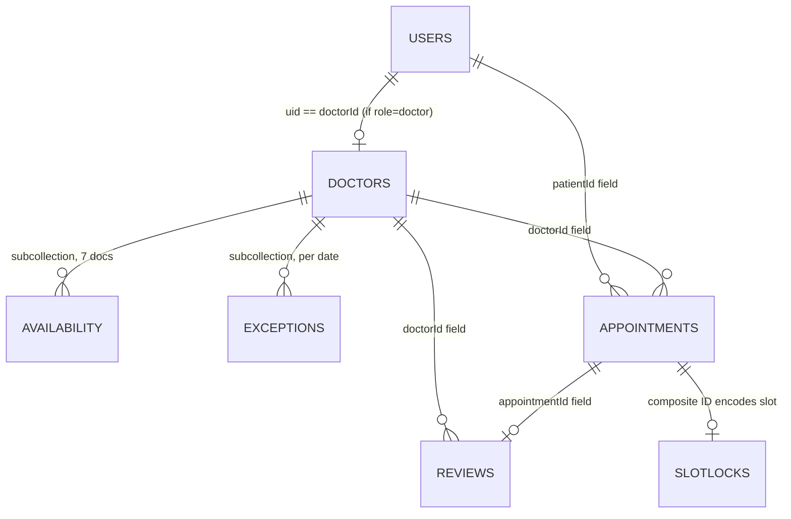

# Doctor Hunt — Documentation & Data-Architecture Audit Report

---

## 1. Files Read

| File | What it defines | Verdict |
|---|---|---|
| [README.md](file:///c:/Users/ebrah/StudioProjects/doctor_hunt/README.md) | Build spec index, locked decisions, build order, known limitations | **Needs work** — app name mismatch, references "MediBook" nowhere but `00` does |
| [00-overview.md](file:///c:/Users/ebrah/StudioProjects/doctor_hunt/docs/00-overview.md) | Product summary, roles, locked decisions, coding rules, doc index | **Needs work** — calls itself "MediBook" (L3), role naming contradictions |
| [01-architecture.md](file:///c:/Users/ebrah/StudioProjects/doctor_hunt/docs/01-architecture.md) | Two-layer design, data flow, error handling, DI, UI state contract | **Needs work** — references non-existent `domain/` in places |
| [02-folder-structure.md](file:///c:/Users/ebrah/StudioProjects/doctor_hunt/docs/02-folder-structure.md) | Directory tree, naming conventions, feature template | **Needs work** — `admin_dashboard/` feature name, generator location discrepancy |
| [03-theming-and-styles.md](file:///c:/Users/ebrah/StudioProjects/doctor_hunt/docs/03-theming-and-styles.md) | Atomic style system, AppColors, ScreenUtil, fixes, ThemeData | **Needs work** — Almarai vs Cairo contradiction in §8 |
| [04-routing-gorouter.md](file:///c:/Users/ebrah/StudioProjects/doctor_hunt/docs/04-routing-gorouter.md) | Routes, SessionService, redirect logic, gotchas, transitions | **Needs work** — uses "admin" naming for doctor role |
| [05-localization-slang.md](file:///c:/Users/ebrah/StudioProjects/doctor_hunt/docs/05-localization-slang.md) | slang setup, EN key tree, RTL rules, bootstrap | **Needs work** — `common.appName` = "MediBook", `flat_map` conflict |
| [06-firebase-and-data-model.md](file:///c:/Users/ebrah/StudioProjects/doctor_hunt/docs/06-firebase-and-data-model.md) | Firebase services, role resolution, Firestore schema, booking tx, security rules | **Needs work** — role value `'admin'` vs `'doctor'` contradiction, missing fields |
| [07-features-and-screens.md](file:///c:/Users/ebrah/StudioProjects/doctor_hunt/docs/07-features-and-screens.md) | Screen-by-screen spec, appointment lifecycle, widget inventory | **Needs work** — mentions "admin" role terminology throughout |
| [08-state-management-branches.md](file:///c:/Users/ebrah/StudioProjects/doctor_hunt/docs/08-state-management-branches.md) | Git strategy, Bloc/Riverpod/GetX patterns, comparison metrics | **Needs work** — references `domain/` folder that doesn't exist |
| [09-conventions-and-setup.md](file:///c:/Users/ebrah/StudioProjects/doctor_hunt/docs/09-conventions-and-setup.md) | pubspec spec, analysis_options, git, codegen, testing, CI, bootstrap | **Needs work** — pubspec name mismatch, SDK version mismatch with actual |
| [10-generator-fixes-changelog.md](file:///c:/Users/ebrah/StudioProjects/doctor_hunt/docs/10-generator-fixes-changelog.md) | All 12 generator fixes with rationale | OK |
| [11-color-system.md](file:///c:/Users/ebrah/StudioProjects/doctor_hunt/docs/11-color-system.md) | Figma palette → 19 tokens, dark derivation, contrast audit | OK |
| [app_colors.dart](file:///c:/Users/ebrah/StudioProjects/doctor_hunt/lib/generated/app_colors.dart) | AppPalette, light/dark palettes, ThemeExtension, shadows | OK |
| [generate_style.dart](file:///c:/Users/ebrah/StudioProjects/doctor_hunt/lib/generated/generate_style.dart) | Style atom generator script (SHOULD be in `tool/`, see findings) | **Needs work** — wrong location |
| [main.dart](file:///c:/Users/ebrah/StudioProjects/doctor_hunt/lib/main.dart) | Default Flutter counter app — untouched scaffold | OK (expected — pre-implementation) |
| [pubspec.yaml](file:///c:/Users/ebrah/StudioProjects/doctor_hunt/pubspec.yaml) | Actual project pubspec — bare-bones Flutter default | **Needs work** — doesn't match docs |
| [analysis_options.yaml](file:///c:/Users/ebrah/StudioProjects/doctor_hunt/analysis_options.yaml) | Default flutter_lints include | OK (expected — pre-implementation) |
| [pubspec.lock](file:///c:/Users/ebrah/StudioProjects/doctor_hunt/pubspec.lock) | Lock file for the default Flutter project | OK |

**Confirmation:** I have read 100% of every file listed above, end-to-end.

---

## 2. Reconstructed Data Architecture

### 2.1 Entity List (as documented)

| Entity | Collection | Doc ID | Purpose |
|---|---|---|---|
| User | `users/{uid}` | Firebase Auth UID | Base user profile + role |
| Doctor | `doctors/{doctorId}` | `doctorId == uid` | Public doctor profile, fees, location, rating aggregate |
| Availability | `doctors/{doctorId}/availability/{weekday}` | `"0"`–`"6"` | Recurring weekly schedule |
| Exception | `doctors/{doctorId}/exceptions/{yyyy-MM-dd}` | Date string | Day-off / custom hours overrides |
| Appointment | `appointments/{appointmentId}` | Auto-ID | Booking record (top-level, queried by both roles) |
| Review | `reviews/{reviewId}` | Auto-ID | Patient review of a completed appointment |
| SlotLock | `slotLocks/{doctorId}_{date}_{startTime}` | Composite key | Concurrency guard for booking |

### 2.2 Relationship Diagram



### 2.3 Collection → Fields (exactly as documented in `06`)

**`users/{uid}`**
| Field | Type | Nullable | Notes |
|---|---|---|---|
| `uid` | string | no | |
| `email` | string | no | |
| `name` | string | no | |
| `phone` | string | no | |
| `photoUrl` | string | yes | |
| `role` | string | no | `"patient"` \| `"doctor"` — immutable after create |
| `createdAt` | Timestamp | no | |
| `updatedAt` | Timestamp | no | |
| `fcmToken` | string | yes | v2 |

**`doctors/{doctorId}`**
| Field | Type | Nullable | Notes |
|---|---|---|---|
| `uid` | string | no | |
| `name` | Map{en,ar} | no | bilingual |
| `specialization` | string | no | enum key |
| `bio` | Map{en,ar} | yes | |
| `photoUrl` | string | yes | |
| `yearsOfExperience` | int | no | |
| `consultationFee` | number | no | |
| `currency` | string | no | |
| `rating` | number | no | denormalised aggregate |
| `ratingCount` | int | no | denormalised |
| `ratingSum` | int | no | kept for exact increments |
| `clinicAddress` | Map{en,ar} | no | |
| `slotDurationMinutes` | int | no | |
| `isActive` | bool | no | |
| `isProfileComplete` | bool | no | gates onboarding wizard |
| `isVerified` | bool | no | recommended demo mitigation |
| `nameSearch` | string | no | lowercased for prefix search |
| `treats` | array\<string\> | no | |
| `clinicPhone` | string | no | |
| `whatsapp` | string | yes | |
| `location.lat` | number | no | |
| `location.lng` | number | no | |
| `location.geohash` | string | yes | only if geoflutterfire adopted |
| `location.address` | Map{en,ar} | no | |
| `createdAt` | Timestamp | no | |

> ⚠️ `rating` appears **twice** in the documented schema (L75-76 and L99-101). The duplicate at L75 has no `ratingSum` — see Finding F-04.

**`doctors/{doctorId}/availability/{weekday}`**
| Field | Type | Notes |
|---|---|---|
| `weekday` | int | 0-6 |
| `isWorking` | bool | |
| `ranges` | array\<{start, end}\> | HH:mm strings |

**`doctors/{doctorId}/exceptions/{yyyy-MM-dd}`**
| Field | Type | Notes |
|---|---|---|
| `date` | string | yyyy-MM-dd |
| `isClosed` | bool | |
| `ranges` | array | custom hours if not closed |

**`appointments/{appointmentId}`**
| Field | Type | Notes |
|---|---|---|
| `id` | string | |
| `doctorId` | string | |
| `doctorName` | string | denormalised |
| `patientId` | string | |
| `patientName` | string | denormalised |
| `patientPhone` | string | |
| `date` | string | yyyy-MM-dd |
| `startTime` | string | HH:mm |
| `endTime` | string | HH:mm |
| `startAt` | Timestamp | full datetime for ordering |
| `status` | string | pending / confirmed / cancelled / completed |
| `notes` | string | |
| `cancelReason` | string? | |
| `cancelledBy` | string? | "patient" \| "admin" |
| `createdAt` | Timestamp | |
| `updatedAt` | Timestamp | |

**`reviews/{reviewId}`**
| Field | Type | Notes |
|---|---|---|
| `id` | string | |
| `doctorId` | string | |
| `patientId` | string | |
| `patientName` | string | denormalised |
| `appointmentId` | string | one review per completed appointment |
| `rating` | int | 1-5 |
| `comment` | string | |
| `createdAt` | Timestamp | |
| `updatedAt` | Timestamp | |

**`slotLocks/{doctorId}_{date}_{startTime}`**
| Field | Type | Notes |
|---|---|---|
| `appointmentId` | string | |
| `createdAt` | Timestamp | server timestamp |

---

## 3. Spec Conformance Matrix

| Requirement | Status | Evidence | Note |
|---|---|---|---|
| **2 roles only (Doctor + Patient)** | ⛔ **Contradicted** | `06 §2` L21 uses `'admin'`, `04` uses `isAdmin` throughout, `02` has `admin_dashboard/`, `07` has "Admin" as section header, `cancelledBy` uses `"admin"` in appointment schema | Docs inconsistently switch between "admin" and "doctor". The Firestore `role` field says `'admin'` in `06 §2` L21 but `'doctor'` in `06 §2` L35. **Blocker** — implementation cannot proceed until this is unified. |
| Doctor creates/manages profile | ✅ Covered | `06 §3` doctors collection, `07 §A5` onboarding wizard, `07 §C4` doctor profile | Complete field list documented |
| Doctor defines location/clinic | ✅ Covered | `06 §3` location object with lat/lng/address, `07 §A5` step 3, `07 §E` | Map picker deferred to v1.1; text address + "open in maps" for v1 |
| Doctor publishes available slots | ✅ Covered | `06 §3` availability subcollection, `07 §C3` availability screen | Recurring weekly model with exceptions |
| Doctor confirms/rejects/cancels bookings | ✅ Covered | `07 §C2` admin appointments screen, `07 §F2` lifecycle | All transitions documented |
| Patient signup/signin/profile | ✅ Covered | `07 §A2-A4`, `07 §B8`, `06 §8` | |
| Patient browses/searches/filters doctors | ✅ Covered | `07 §B1-B2`, `06 §5` indexes | By name and specialization. Rating filter index exists but no UI documented for it |
| Patient views doctor + available slots | ✅ Covered | `07 §B4-B5`, `01 §3` slot calculator | |
| Patient books a time slot | ✅ Covered | `07 §B5`, `06 §4` booking transaction | Transaction + slotLock documented |
| Patient views/cancels appointments | ✅ Covered | `07 §B6` my appointments | Reschedule is **not** documented — see F-10 |
| **T1: ScreenUtil** | ✅ Covered | `03 §7`, `09 §1` pubspec, generator Fix #3 in `10` | Design size 375×812, `.sp` in generator, `.w`/`.h`/`.r` at call sites |
| **T2: AppColors only** | ✅ Covered | `03 §2`, `11`, `app_colors.dart` file, `00 §4` rule #1 | Two palettes, ThemeExtension, dark mode |
| **T3: Generated text styles** | ✅ Covered | `03 §1`, `10`, `generate_style.dart` file | 1,425 getters verified |
| **T4: go_router** | ✅ Covered | `04` full router definition, named routes, redirect logic, `Navigator.push` forbidden | |
| **T5: Firebase backend** | ⚠️ **Partial** | `06 §1` lists Auth + Firestore + Storage; `09 §1` pubspec lists packages | FCM deferred; Cloud Functions mentioned as "production path" but not in scope. **Missing: no `firebase_options.dart` setup steps are documented** (only mentioned in passing in `06 §8`). |

---

## 4. Findings

### F-01 · **Blocker** · Contradiction
**Where:** [06 §2 L21](file:///c:/Users/ebrah/StudioProjects/doctor_hunt/docs/06-firebase-and-data-model.md#L21) vs [06 §2 L35](file:///c:/Users/ebrah/StudioProjects/doctor_hunt/docs/06-firebase-and-data-model.md#L35)
**What the docs say now:** L21: `role` field = `'admin' | 'patient'`. L35: `role` must be one of `['patient', 'doctor']`.
**Why it's a problem:** The actual Firestore string value is undefined. If the security rule says `in ['patient', 'doctor']` but the app writes `'admin'`, every doctor registration fails. Every downstream consumer (`SessionService`, router redirect, security rules) depends on this value.
**Proposed fix:** Standardise on `'doctor'` everywhere. `'admin'` is misleading — there is no admin role, just a doctor who manages their own clinic. Replace `'admin'` → `'doctor'` in `06 §2 L21`, and audit all files for `isAdmin` / `adminHome` / `admin_dashboard` naming (see F-02).

---

### F-02 · **Blocker** · Contradiction
**Where:** Across `04`, `06`, `07`, `02`
**What the docs say now:** Routes use `adminHome`, `adminRequests`, `adminAvailability`. Folder is `admin_dashboard/`. Feature screens are `admin_dashboard_screen.dart`. `cancelledBy` value is `"admin"`. Section headers in `07` say "Admin (Doctor)".
**Why it's a problem:** The spec says there are exactly two roles: Doctor and Patient. There is no admin. Using "admin" throughout is confusing and will lead to naming inconsistencies in code. More critically, `cancelledBy: "admin"` in the appointment schema must match whatever string the code actually writes — if the code writes `"doctor"` (matching the role field) but the schema documents `"admin"`, every cancel-attribution query breaks.
**Proposed fix:** Global rename: `admin` → `doctor` in route names, path constants, folder names, schema field values. Specifically:
- Routes: `adminHome` → `doctorHome`, `adminRequests` → `doctorAppointments`, `adminAvailability` → `doctorAvailability`, `adminReviews` → `doctorReviews`
- Paths: `/admin` → `/doctor`, `/admin/requests` → `/doctor/appointments`
- Folder: `admin_dashboard/` → `doctor_dashboard/` (or just use the existing `doctors/` feature)
- `cancelledBy` values: `"admin"` → `"doctor"`
- `SessionState.isAdmin` → `SessionState.isDoctor`

---

### F-03 · **Blocker** · Contradiction
**Where:** [00 §1 L3](file:///c:/Users/ebrah/StudioProjects/doctor_hunt/docs/00-overview.md#L3), [05 §2 L89](file:///c:/Users/ebrah/StudioProjects/doctor_hunt/docs/05-localization-slang.md#L89), [09 §1 L6](file:///c:/Users/ebrah/StudioProjects/doctor_hunt/docs/09-conventions-and-setup.md#L6) vs [README.md L1](file:///c:/Users/ebrah/StudioProjects/doctor_hunt/README.md#L1), [pubspec.yaml L1](file:///c:/Users/ebrah/StudioProjects/doctor_hunt/pubspec.yaml#L1)
**What the docs say now:** `00` L3 calls the app "MediBook". `05` L89 sets `common.appName` = `"MediBook"`. `09` L6 sets `name: medibook`. But the README title is "Doctor Hunt", the actual `pubspec.yaml` says `name: doctor_hunt`, and `11` L1 says "Colour System (Doctor Hunt)".
**Why it's a problem:** The app has two names. The pubspec `name` is the Dart package name and affects every import. This must be settled before a single import is written.
**Proposed fix:** Unify on **"Doctor Hunt"** (the repo name and README title). Change:
- `00 §1 L3`: "MediBook" → "Doctor Hunt"
- `05 §2 L89`: `"appName": "MediBook"` → `"appName": "Doctor Hunt"`
- `09 §1 L6`: `name: medibook` → `name: doctor_hunt`

---

### F-04 · **High** · Wrong
**Where:** [06 §3 L75-76](file:///c:/Users/ebrah/StudioProjects/doctor_hunt/docs/06-firebase-and-data-model.md#L75-L76) and [06 §3 L99-102](file:///c:/Users/ebrah/StudioProjects/doctor_hunt/docs/06-firebase-and-data-model.md#L99-L102)
**What the docs say now:** `rating` and `ratingCount` appear twice in the `doctors` schema — once at L75-76 with no `ratingSum`, and again at L99-102 with `ratingSum`. The first occurrence is a stale duplicate.
**Why it's a problem:** A developer copying the schema verbatim gets a compile error from duplicate fields. More subtly, the first occurrence lacks `ratingSum`, which is needed for incremental average updates.
**Proposed fix:** Delete the `rating` and `ratingCount` entries at L75-76 and keep only the rating aggregate block at L99-102 (which has `ratingSum`).

---

### F-05 · **High** · Contradiction
**Where:** [03 §8 L350-368](file:///c:/Users/ebrah/StudioProjects/doctor_hunt/docs/03-theming-and-styles.md#L350-L368)
**What the docs say now:** Section title is "Almarai + Localization" and provides Almarai pubspec entries (L356-363). Then L365-368 says "✅ Decided: Cairo" and explains why Cairo is better. The section title, body text, and pubspec snippet all contradict the decision.
**Why it's a problem:** A developer reading top-down will register Almarai font files. The correction at the bottom is easy to miss. `09 §1` correctly lists Cairo, so the conflict is within `03` itself.
**Proposed fix:** Rewrite `03 §8` entirely:
- Title: "Font: Cairo"
- Remove the Almarai pubspec snippet
- Keep only the Cairo rationale and reference `09 §1` for the pubspec entries

---

### F-06 · **High** · Contradiction
**Where:** [02 §2 L104](file:///c:/Users/ebrah/StudioProjects/doctor_hunt/docs/02-folder-structure.md#L104) vs [09 §1 L84](file:///c:/Users/ebrah/StudioProjects/doctor_hunt/docs/09-conventions-and-setup.md#L84)
**What the docs say now:** `02` L104: `font_family.dart` contains `'Almarai'`. `09` L84-95: `pubspec.yaml` declares `family: Cairo`.
**Why it's a problem:** `font_family.dart` would export `static const String almarai = 'Almarai'` which doesn't match the `Cairo` family in `pubspec.yaml`. The generator and `AppTheme` will use the wrong font.
**Proposed fix:** Change `02` L104 to say `'Cairo' constant — see 03 §8` and ensure `font_family.dart` exports `static const String cairo = 'Cairo'`. (This is already correctly shown in `03 §7 L344`, but `02` disagrees.)

---

### F-07 · **High** · Wrong
**Where:** [generate_style.dart](file:///c:/Users/ebrah/StudioProjects/doctor_hunt/lib/generated/generate_style.dart) — file location
**What the docs say now:** `02 §4`, `10 §header`, and `09 §4` all agree the generator must live at `tool/generate_style.dart` (outside `lib/`). The actual file is at `lib/generated/generate_style.dart`.
**Why it's a problem:** `dart:io` is imported. This file inside `lib/` will be compiled into the Flutter app bundle. On Flutter Web this is a hard build failure. On mobile it's dead code in the binary.
**Proposed fix:** Move `lib/generated/generate_style.dart` → `tool/generate_style.dart`. (This is a file-system fix, not a doc fix — the docs are correct.)

---

### F-08 · **High** · Missing
**Where:** [06 §3](file:///c:/Users/ebrah/StudioProjects/doctor_hunt/docs/06-firebase-and-data-model.md) — appointment schema
**What the docs say now:** `doctorName` is stored as a plain string `"Dr. Ahmed Hassan"` (L136). But the `doctors` collection stores `name` as a bilingual map `{"en": "...", "ar": "..."}` (L68).
**Why it's a problem:** Which language is denormalised onto the appointment? If the patient views appointments in Arabic, they'll see the English name. The denormalization strategy for bilingual fields is not documented.
**Proposed fix:** Either:
- (a) Store `doctorName` as a bilingual map on the appointment too, OR
- (b) Store both `doctorNameEn` and `doctorNameAr`, OR
- (c) Document that the denormalised name uses the doctor's language at creation time (cheapest, but lossy).
Same issue applies to `patientName` if patient names are ever bilingual (currently they are not — patients have a simple `name` string in `users/`).

---

### F-09 · **High** · Missing
**Where:** Not documented anywhere
**What the docs say now:** The `appointments` schema has denormalised `doctorName` (L136) and `patientName` (L138). There is **no documented update/consistency strategy** for when a doctor or patient changes their name.
**Why it's a problem:** If Dr. Ahmed updates his name, all existing appointments still show the old name. For a portfolio demo this is probably acceptable, but it should be documented as a known limitation.
**Proposed fix:** Add to `06` after the schema: "**Denormalization note:** `doctorName` and `patientName` on appointments are snapshot values captured at booking time and are not updated retroactively. This is a known trade-off for avoiding N+1 reads."

---

### F-10 · **High** · Missing
**Where:** The audit prompt Section 2 says "cancels / reschedules"
**What the docs say now:** Cancel is documented in `07 §B6` and `07 §F2`. **Reschedule is never mentioned anywhere.** The appointment lifecycle in `07 §F2` has no "reschedule" transition.
**Why it's a problem:** The spec says "cancels / reschedules" for patients. If reschedule means "cancel + re-book", the docs should say so explicitly. If it's out of scope, it should be listed as such.
**Proposed fix:** Add a note to `07 §B6`: "**Reschedule** is implemented as cancel + new booking. There is no atomic reschedule operation in v1." Or if reschedule is out of scope, add it to the deferred features list.

---

### F-11 · **High** · Missing
**Where:** [06 §6](file:///c:/Users/ebrah/StudioProjects/doctor_hunt/docs/06-firebase-and-data-model.md#L220) — security rules
**What the docs say now:** `users/{userId}` allow read: `signedIn() && (uid() == userId || isAdmin())`. This means any doctor can read any user's profile.
**Why it's a problem:** A doctor can read **any patient's** profile data (phone number, email) even if that patient has never booked with them. For a portfolio project this is low-risk, but it's a privacy hole that should be documented.
**Proposed fix:** Either tighten the rule to `uid() == userId` (both roles can only read their own profile), or document this as an accepted risk: "Doctors can read any user profile — this enables looking up patient contact info for bookings. For production, restrict to patients who have booked with the doctor."

---

### F-12 · **High** · Missing
**Where:** [06 §6 L276-277](file:///c:/Users/ebrah/StudioProjects/doctor_hunt/docs/06-firebase-and-data-model.md#L276-L277)
**What the docs say now:** `slotLocks` — `allow create, delete: if signedIn()` — any authenticated user can create or delete any slot lock.
**Why it's a problem:** A malicious patient could delete another patient's slot lock, freeing the slot and enabling a double-booking. Or they could create fake locks to block all of a doctor's slots (denial of service). The docs note "tighten in v2" but don't document the risk for v1.
**Proposed fix:** Add:
```js
allow create: if signedIn() && request.resource.data.appointmentId is string;
allow delete: if signedIn()
  && (get(/databases/$(database)/documents/appointments/$(resource.data.appointmentId)).data.patientId == uid()
      || get(/databases/$(database)/documents/appointments/$(resource.data.appointmentId)).data.doctorId == uid());
```
Or at minimum document the risk explicitly.

---

### F-13 · **Medium** · Contradiction
**Where:** [08 §1 L8](file:///c:/Users/ebrah/StudioProjects/doctor_hunt/docs/08-state-management-branches.md#L8), [08 §5 L205](file:///c:/Users/ebrah/StudioProjects/doctor_hunt/docs/08-state-management-branches.md#L205)
**What the docs say now:** L8: `# ... core/, i18n/, data/, domain/, shared widgets...`. L205: `features/*/domain/*` should be byte-identical across branches.
**Why it's a problem:** There is no `domain/` layer. `00`, `01`, `02` all explicitly say it was dropped. `08` still references it in two places.
**Proposed fix:** L8: remove `domain/` from the comment. L205: delete the `features/*/domain/*` row from the identity table.

---

### F-14 · **Medium** · Contradiction
**Where:** [01 §6 L76-80](file:///c:/Users/ebrah/StudioProjects/doctor_hunt/docs/01-architecture.md#L76-L80), [08 §2 L72-80](file:///c:/Users/ebrah/StudioProjects/doctor_hunt/docs/08-state-management-branches.md#L72-L80)
**What the docs say now:** Both Bloc examples reference `SignInUseCase` and `SignInWithGoogleUseCase`. The Riverpod example (L113) references `signInUseCaseProvider`. The GetX example (L159) references `SignInUseCase`.
**Why it's a problem:** Use cases don't exist in this architecture — there is no `domain/` layer. Controllers should call repos directly, per `01 §1`. The code examples in `08` still use the old Clean Architecture pattern.
**Proposed fix:** Replace `_signIn(SignInParams(...))` with `_repo.signIn(email, password)` in all three branch examples. Remove `SignInParams` — parameters go directly to the repo method.

---

### F-15 · **Medium** · Ambiguous
**Where:** [06 §3 L69](file:///c:/Users/ebrah/StudioProjects/doctor_hunt/docs/06-firebase-and-data-model.md#L69)
**What the docs say now:** `specialization` is described as `"enum key, translated client-side via slang"`. But no list of specialization values is documented anywhere.
**Why it's a problem:** The client needs a fixed enum of specializations to: (a) populate the dropdown in doctor onboarding, (b) display specialization filter chips, (c) translate them via slang keys. Without the list, implementations will invent their own values and localisation keys won't match.
**Proposed fix:** Add a `Specializations` enum or list to `06` or `07` with values like: `general`, `cardiology`, `dermatology`, `orthopedics`, `pediatrics`, `neurology`, `dentistry`, `ophthalmology`. Add matching slang keys to the key tree in `05`.

---

### F-16 · **Medium** · Missing
**Where:** [05 §2](file:///c:/Users/ebrah/StudioProjects/doctor_hunt/docs/05-localization-slang.md#L86-L242)
**What the docs say now:** There are no slang keys for specializations, no `t.specializations.*` namespace. The doctor onboarding wizard references "specialization (dropdown from a fixed enum)" but the enum values are not translated.
**Why it's a problem:** Specialization names will display as raw enum keys (e.g., `"cardiology"`) instead of localised labels in AR. This breaks the no-hardcoded-strings rule.
**Proposed fix:** Add a `specializations` namespace to the slang key tree with entries for each specialization value.

---

### F-17 · **Medium** · Missing
**Where:** Not documented anywhere
**What the docs say now:** The appointment status `cancelled` has a `cancelReason` and `cancelledBy` field, but the lifecycle diagram (`07 §F2`) doesn't mention **rejection** as a distinct concept. The accept/reject buttons in `07 §C2` imply reject → cancelled.
**Why it's a problem:** Is "doctor rejects" the same as "doctor cancels"? If so, should `cancelledBy` be `"doctor"` and `cancelReason` be `"rejected"`? Or should there be a separate `rejected` status? The current lifecycle shows both "doctor rejects" and "patient cancels" → `cancelled`, but doesn't clarify `cancelledBy` values for rejection.
**Proposed fix:** Add a note: "Rejection is modelled as cancellation with `cancelledBy: 'doctor'` and `cancelReason: 'rejected'`. There is no separate `rejected` status."

---

### F-18 · **Medium** · Ambiguous
**Where:** [06 §3 L140](file:///c:/Users/ebrah/StudioProjects/doctor_hunt/docs/06-firebase-and-data-model.md#L140), [06 §3 L143](file:///c:/Users/ebrah/StudioProjects/doctor_hunt/docs/06-firebase-and-data-model.md#L143)
**What the docs say now:** `date` is a `string` (`"yyyy-MM-dd"`), `startTime` is a `string` (`"HH:mm 24h"`), `startAt` is a `Timestamp` (full datetime). `date` is used for equality queries, `startAt` for ordering.
**Why it's a problem:** The dual representation is pragmatic but the docs don't specify **timezone handling**. What timezone is `date: "2026-10-06"` in? If the doctor is in Cairo (UTC+2) and the system writes `startAt` as UTC, the `date` string and `startAt.toDate()` can disagree across the midnight boundary. Filtering appointments by `date` string and ordering by `startAt` could produce inconsistent results.
**Proposed fix:** Add a "Time handling" note: "All date strings and Timestamps use **Cairo local time** (the app's only deployment region in v1). `startAt` is constructed as `DateTime(date.year, date.month, date.day, hour, minute)` in local time, then stored as a Firestore Timestamp (which converts to UTC internally). The `date` string is always the local date."

---

### F-19 · **Medium** · Wrong
**Where:** [09 §1 L11](file:///c:/Users/ebrah/StudioProjects/doctor_hunt/docs/09-conventions-and-setup.md#L11) vs actual [pubspec.yaml L22](file:///c:/Users/ebrah/StudioProjects/doctor_hunt/pubspec.yaml#L22)
**What the docs say now:** `09` specifies `sdk: ^3.5.0`. Actual pubspec says `sdk: ^3.12.2`.
**Why it's a problem:** When the documented pubspec is copied over the real one, the SDK constraint will downgrade, potentially allowing older SDKs that lack required features (records, patterns, sealed classes).
**Proposed fix:** Update `09` L11 to `sdk: ^3.12.2` (or whatever the project actually needs). The actual pubspec is newer and should be the source of truth.

---

### F-20 · **Medium** · Missing
**Where:** [07 §D L242](file:///c:/Users/ebrah/StudioProjects/doctor_hunt/docs/07-features-and-screens.md#L242)
**What the docs say now:** "light only in v1 — see `10 §11`"
**Why it's a problem:** This directly contradicts `03 §6` which documents full light+dark ThemeData, `10 §Fix #11` which implements dark mode in the generator, `11` which provides a complete dark palette with contrast audit, and `app_colors.dart` which ships both palettes. Dark mode is clearly in scope. This is a stale note.
**Proposed fix:** Change to: "Theme: light + dark (via `ThemeMode.system` default), language (EN/AR), sign out, about/version."

---

### F-21 · **Medium** · Missing
**Where:** [06 §8](file:///c:/Users/ebrah/StudioProjects/doctor_hunt/docs/06-firebase-and-data-model.md#L340-L341)
**What the docs say now:** "First Google sign-in has no Firestore doc yet. After `signInWithCredential`, check `additionalUserInfo.isNewUser` → if true, create `users/{uid}` with `role: 'patient'`"
**Why it's a problem:** This hardcodes Google sign-in users to `patient`. But the spec says doctors can also self-register, and the role selection screen comes first. A doctor who signs up via Google would be forced into the patient role.
**Proposed fix:** Google sign-in from the role selection screen should pass the chosen role. From the login screen, Google sign-in should check if a user doc already exists → if not, redirect to role selection first. Document the two flows explicitly.

---

### F-22 · **Medium** · Missing
**Where:** Not documented anywhere
**What the docs say now:** The spec mentions "account deletion" as something to verify. It is not documented in any auth flow, screen, or setting.
**Why it's a problem:** Apple App Store requires account deletion capability. Even for a portfolio project, this is a UX gap.
**Proposed fix:** Add account deletion to `07 §D` (Settings) and `06 §8` (Auth notes): "Delete account: calls `FirebaseAuth.currentUser.delete()`, cascades by deleting `users/{uid}` and `doctors/{uid}` (if doctor). Warn that this cannot be undone."

---

### F-23 · **Medium** · Missing
**Where:** Not documented anywhere
**What the docs say now:** `email verification` is mentioned once at `06 §8 L342`: "send on sign-up, but don't hard-block login in v1 — show a banner." But there are no slang keys for the verification banner, no screen spec, and no indication of where the banner should appear.
**Why it's a problem:** An implementor won't know what the banner says, where it appears, or how to dismiss it.
**Proposed fix:** Add a `t.auth.emailNotVerified` key to `05` and specify in `07` that the banner appears on the home screen for unverified users.

---

### F-24 · **Low** · Naming consistency
**Where:** Across all docs
**What the docs say now:** The doctor role is called: `admin` (routes, sessions, folders), `doctor` (role field, collection name, user-facing), `Admin (Doctor)` (07 headers). Route names mix both.
**Why it's a problem:** Inconsistent naming creates cognitive overhead and makes grep-based auditing unreliable.
**Proposed fix:** Resolved by F-02.

---

### F-25 · **Low** · Naming consistency
**Where:** [04 §4 L183](file:///c:/Users/ebrah/StudioProjects/doctor_hunt/docs/04-routing-gorouter.md#L183), [07 §A6](file:///c:/Users/ebrah/StudioProjects/doctor_hunt/docs/07-features-and-screens.md#L97)
**What the docs say now:** Route builder for forgot password creates `ForgotPasswordPage()`. Screen spec calls it `forgot_password_screen.dart`. Class name convention says suffix `Screen`, not `Page`.
**Why it's a problem:** `04` uses `Page` suffix for some screens (`PatientHomePage`, `DoctorDetailsPage`, `BookAppointmentPage`, `MyAppointmentsPage`, `ProfilePage`, `NotFoundPage`) while `07` and `02` consistently use `Screen`. Mixed naming.
**Proposed fix:** Standardise on `Screen` suffix everywhere per the naming convention in `02 §5`. Replace all `*Page` references in `04` with `*Screen`.

---

### F-26 · **Low** · Missing
**Where:** [02 §2](file:///c:/Users/ebrah/StudioProjects/doctor_hunt/docs/02-folder-structure.md#L58-L166)
**What the docs say now:** The folder structure shows `core/router/` as the folder name. But `04` uses `core/routing/` in all its file paths (e.g., `core/routing/app_router.dart`, `core/routing/routes.dart`).
**Why it's a problem:** Import paths will differ depending on which doc the developer follows.
**Proposed fix:** Unify on `core/router/` (matching the screenshot in `02`) and update all paths in `04`.

---

### F-27 · **Low** · Docs vs pubspec
**Where:** [09 §1](file:///c:/Users/ebrah/StudioProjects/doctor_hunt/docs/09-conventions-and-setup.md#L5-L96) vs actual [pubspec.yaml](file:///c:/Users/ebrah/StudioProjects/doctor_hunt/pubspec.yaml)
**What the docs say now:** `09` specifies a comprehensive pubspec with ~25 dependencies. The actual `pubspec.yaml` is the default Flutter counter-app template with only `cupertino_icons` and `flutter_lints`.
**Why it's a problem:** Expected — the docs are the spec, the actual project hasn't been set up yet. But the actual pubspec uses `flutter_lints: ^6.0.0` while `09` specifies `flutter_lints: ^4.0.0`. Neither matches the latest (`^5.0.0`). Also the actual pubspec has `cupertino_icons` which isn't in the docs.
**Proposed fix:** When setting up, copy from `09` as the source of truth. Remove `cupertino_icons` (not needed with Material Icons). Align `flutter_lints` version.

---

### F-28 · **Low** · Wrong
**Where:** [05 §4 L308](file:///c:/Users/ebrah/StudioProjects/doctor_hunt/docs/05-localization-slang.md#L308)
**What the docs say now:** `String messageFor(Failure f) => t[f.messageKey] ?? t.errors.server;` with note "needs `flat_map: true`". But `build.yaml` (L54) says `flat_map: false`. The next paragraph recommends the `switch` approach instead.
**Why it's a problem:** The `t[f.messageKey]` code example won't compile with `flat_map: false`. The docs recommend against it but still show it as the first code example.
**Proposed fix:** Remove the `t[f.messageKey]` example or add a clear "❌ don't use this" prefix. Keep only the `switch`-based `failureMessage()` as the recommended pattern.

---

### F-29 · **Low** · Unused
**Where:** [00 §3 L69](file:///c:/Users/ebrah/StudioProjects/doctor_hunt/docs/00-overview.md#L69)
**What the docs say now:** "if you find yourself editing a file under `core/`, `domain/`, or `data/` inside a feature branch — stop"
**Why it's a problem:** References `domain/` which doesn't exist.
**Proposed fix:** Remove `domain/` from the sentence.

---

### F-30 · **Low** · Missing
**Where:** [01 §4 L138-141](file:///c:/Users/ebrah/StudioProjects/doctor_hunt/docs/01-architecture.md#L138-L141)
**What the docs say now:** `AuthFailure` has a `final String code` field. `00 §4` rule says "failures carry no strings". `01 §4 L144` says "Failures carry **no message string**".
**Why it's a problem:** `AuthFailure.code` is a string (e.g., `'invalid-credential'`). The "no strings" rule is about user-facing message strings — `code` is a machine-readable Firebase error code, not a message. But the wording is ambiguous.
**Proposed fix:** Clarify: "Failures carry **no user-facing message strings** — the UI maps them to slang keys. Machine-readable codes (like `AuthFailure.code`) are allowed as they're the input to the mapping function."

---

## 5. Unused / Out-of-scope Inventory

| Item | Where | Referenced by | Recommendation |
|---|---|---|---|
| `admin_dashboard/` feature folder | `02 §2 L143` | `07 §C1` (as screen) | **Rename** to `doctor_dashboard/` per F-02 |
| `features/*/domain/*` row | `08 §5 L205` | Nothing — domain was dropped | **Delete** |
| `domain/` reference in branch rule | `00 §3 L69` | Nothing | **Delete** the word `domain/` |
| `UseCases` in branch examples | `08 §2-4` code snippets | Nothing — no use-case layer exists | **Rewrite** examples per F-14 |
| `ForgotPasswordPage` class name | `04 §4 L183` | Inconsistent with `Screen` convention | **Rename** to `ForgotPasswordScreen` |
| `MediBook` app name | `00 L3`, `05 L89`, `09 L6` | Only in these 3 places | **Delete** — rename to "Doctor Hunt" per F-03 |
| `noShow` status | Audit prompt §3.1 asks about it | Not documented in any doc | **Confirm** — not in scope. If desired, add to the enum. |
| Maps UI features (map picker, nearby map, distance) | `07 §B3`, `07 §E` | Schema reserved | **Keep as deferred to v1.1** — already marked clearly |
| Chat / video calls / payments / prescriptions | Not mentioned in any doc | — | **Not present** — no action needed |
| `image_assets.dart` | `02 §2 L149` | Mentioned as a generated file | **Keep** — it will be needed for asset path constants |
| `geoflutterfire_plus` / geohash | `06 §3 L95`, `07 §B3` | Schema has optional `geohash` field | **Keep as deferred** — field is optional |
| `isVerified` field on doctors | `06 §3 L81` | `06 §5` index, `06 §2` recommendation | **Keep** — recommended mitigation |
| `fcmToken` on users | `06 §3 L59` | Nothing in v1 | **Keep** — labelled v2, costs nothing |

---

## 6. MD File Change Plan

### [00-overview.md](file:///c:/Users/ebrah/StudioProjects/doctor_hunt/docs/00-overview.md)
1. L3: "MediBook" → "Doctor Hunt" (F-03)
2. L13: "Admin (Doctor)" → "Doctor" role label (F-02)
3. L69: Remove `domain/` from the branch rule text (F-29)

### [01-architecture.md](file:///c:/Users/ebrah/StudioProjects/doctor_hunt/docs/01-architecture.md)
1. L144: Clarify "no message strings" vs machine codes (F-30)

### [02-folder-structure.md](file:///c:/Users/ebrah/StudioProjects/doctor_hunt/docs/02-folder-structure.md)
1. L83-84: Rename `core/router/` or update to match `04`'s `core/routing/` — pick one (F-26)
2. L104: `'Almarai'` → `'Cairo'` (F-06)
3. L143: `admin_dashboard/` → `doctor_dashboard/` (F-02)

### [03-theming-and-styles.md](file:///c:/Users/ebrah/StudioProjects/doctor_hunt/docs/03-theming-and-styles.md)
1. §8 (L350-368): Rewrite section. Title → "Font: Cairo". Remove Almarai pubspec snippet. Keep Cairo rationale only. (F-05)

### [04-routing-gorouter.md](file:///c:/Users/ebrah/StudioProjects/doctor_hunt/docs/04-routing-gorouter.md)
1. L30-34: Rename `admin*` routes to `doctor*` (F-02)
2. L55-57: Rename `/admin` paths to `/doctor` (F-02)
3. L105, L160, L164-165: `isAdmin` → `isDoctor`, `s.isAdmin` → `s.isDoctor` (F-02)
4. L183: `ForgotPasswordPage` → `ForgotPasswordScreen` (F-25)
5. All `*Page` → `*Screen` throughout (F-25)

### [05-localization-slang.md](file:///c:/Users/ebrah/StudioProjects/doctor_hunt/docs/05-localization-slang.md)
1. L89: `"appName": "MediBook"` → `"appName": "Doctor Hunt"` (F-03)
2. L199-208: `"admin"` namespace → `"doctor"` namespace (F-02)
3. L308: Remove or prefix with ❌ the `t[f.messageKey]` example (F-28)
4. Add `"specializations"` namespace with enum values (F-16)

### [06-firebase-and-data-model.md](file:///c:/Users/ebrah/StudioProjects/doctor_hunt/docs/06-firebase-and-data-model.md)
1. L21: `'admin'` → `'doctor'` in role field value (F-01)
2. L75-76: Delete duplicate `rating`/`ratingCount` fields (F-04)
3. L136: Document bilingual denormalisation strategy for `doctorName` (F-08)
4. After L165: Add denormalization consistency note (F-09)
5. L229: `isAdmin()` alias → `isDoctor()` (F-02)
6. L232: Update user read rule or document the risk (F-11)
7. L276-277: Tighten `slotLocks` rules or document the risk (F-12)
8. L340-341: Fix Google sign-in to support both roles (F-21)
9. Add timezone handling note after the schema (F-18)
10. Add specialization enum values (F-15)

### [07-features-and-screens.md](file:///c:/Users/ebrah/StudioProjects/doctor_hunt/docs/07-features-and-screens.md)
1. All "Admin" section headers → "Doctor" (F-02)
2. L147: `cancelledBy: "admin"` → `"doctor"` (F-02)
3. L182: Add note about reschedule = cancel + re-book (F-10)
4. L189: Add rejection = cancellation + `cancelledBy: 'doctor'` note (F-17)
5. L242: Fix dark mode status — dark mode IS in scope (F-20)
6. Add account deletion to Settings (F-22)
7. Add email verification banner spec (F-23)

### [08-state-management-branches.md](file:///c:/Users/ebrah/StudioProjects/doctor_hunt/docs/08-state-management-branches.md)
1. L8: Remove `domain/` from comment (F-13)
2. L72-80, L106-124, L159-180: Replace use-case references with direct repo calls (F-14)
3. L205: Delete `features/*/domain/*` row (F-13)

### [09-conventions-and-setup.md](file:///c:/Users/ebrah/StudioProjects/doctor_hunt/docs/09-conventions-and-setup.md)
1. L6: `name: medibook` → `name: doctor_hunt` (F-03)
2. L11: `sdk: ^3.5.0` → `sdk: ^3.12.2` (F-19)

### Physical file move (not a doc edit)
1. Move `lib/generated/generate_style.dart` → `tool/generate_style.dart` (F-07)

---

## 7. Open Questions

| # | Question | Impact | Recommended default |
|---|---|---|---|
| 1 | **Should `admin`→`doctor` renaming include route paths?** Changing `/admin` to `/doctor` also changes deep link URLs. | Medium | **Yes, rename.** No deep links exist yet (v1 has no web build), so there's no breaking change. |
| 2 | **Which folder name: `core/router/` or `core/routing/`?** `02` says `router/`, `04` says `routing/`. | Low | **`core/router/`** — matches the screenshot that `02` is based on. Update `04`. |
| 3 | **`Page` vs `Screen` suffix — is the spec's `Screen` final?** `04`'s router code uses `Page`. | Low | **`Screen`** — it's the stated convention. Update `04`'s code examples. |
| 4 | **Reschedule: cancel+rebook or a proper reschedule flow?** | Medium | **Cancel + rebook** for v1. Document it. Consider atomic reschedule in v2. |
| 5 | **Google sign-in: should it always default to `patient`, or go through role selection?** | High | **First Google sign-in should redirect to role selection** if no user doc exists. This keeps the flow consistent with email registration. |
| 6 | **Bilingual `doctorName` on appointments: map or single string?** | Medium | **Bilingual map** `{"en": "...", "ar": "..."}` — consistent with the doctor's `name` field and supports both locales. |
| 7 | **Account deletion: in v1 or deferred?** | Medium | **v1** — Apple requires it. Implement in Settings with a confirmation dialog. |
| 8 | **Specialization enum: how many and which values?** | Medium | Go with **8 common specialisations** for the demo. Enough for filtering to be meaningful, few enough to seed realistically. |
| 9 | **Arabic-Indic vs Western numerals?** (from README "Still Open") | Low | **Western** — already recommended in the docs. Close this. |
| 10 | **`noShow` status: include or exclude?** The audit prompt asks about it. | Low | **Exclude for v1.** It requires a trigger (Cloud Function or manual) and adds complexity. Defer to v2 with auto-complete. |

---

## 8. Go / No-Go

**No-Go for implementation — minimum fixes required before starting:**

The documentation is 85% ready. The architecture is sound, the booking transaction is correctly designed, the style system is well-thought-out, and the three-branch strategy is clearly defined. However, **three Blockers must be resolved first:**

1. **F-01 + F-02: The `admin` vs `doctor` role value/naming contradiction.** Every file in the project is affected. The Firestore role value (`'admin'` vs `'doctor'`), all route names, folder names, `SessionState` property names, and `cancelledBy` field values must be unified before the first line of implementation code. This is a 30-minute find-and-replace, but it touches every doc.

2. **F-03: The app name (`MediBook` vs `Doctor Hunt`).** The pubspec `name:` field is the Dart package name. This must be settled to `doctor_hunt` before any imports are written.

3. **F-14: Use-case references in the state management examples.** The branch code examples call `SignInUseCase` which doesn't exist in this two-layer architecture. Developers following the examples will create files that don't belong.

After fixing these three plus the **High** findings (F-04 through F-12), the docs are ready for implementation. The **Medium** and **Low** findings can be fixed during implementation without blocking.

**STOPPED. Awaiting your explicit approval before editing any file.**
